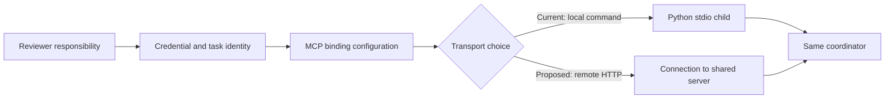
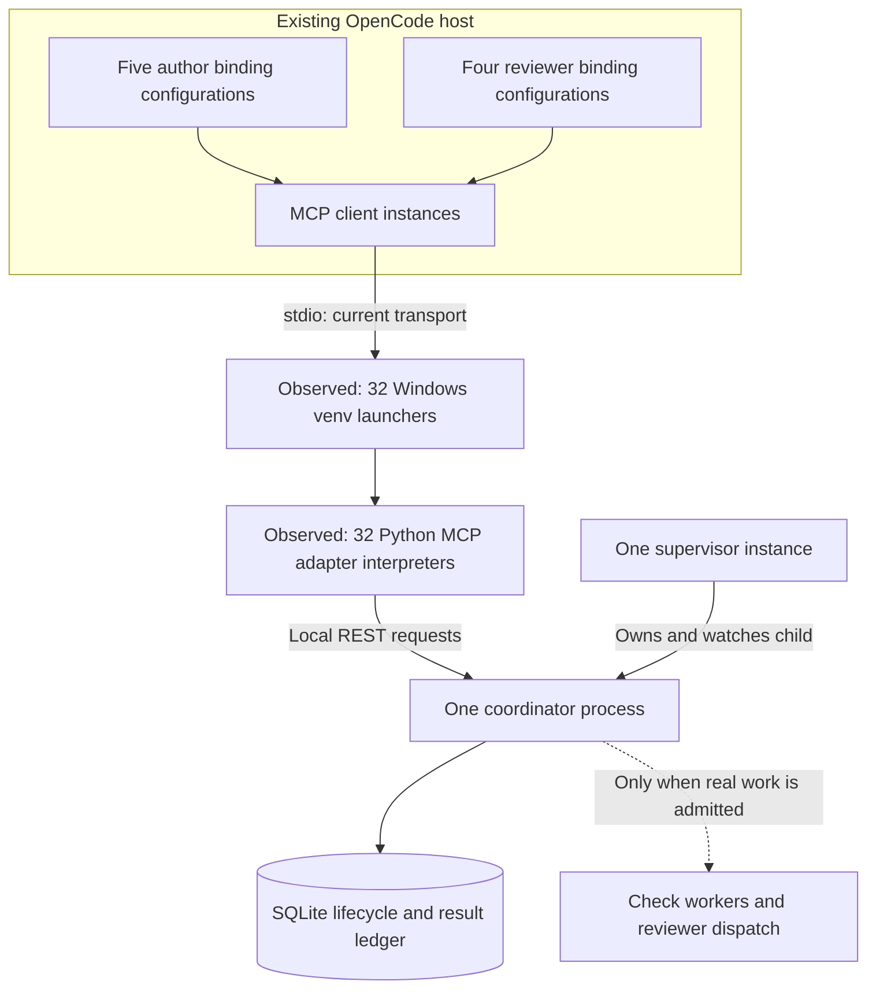
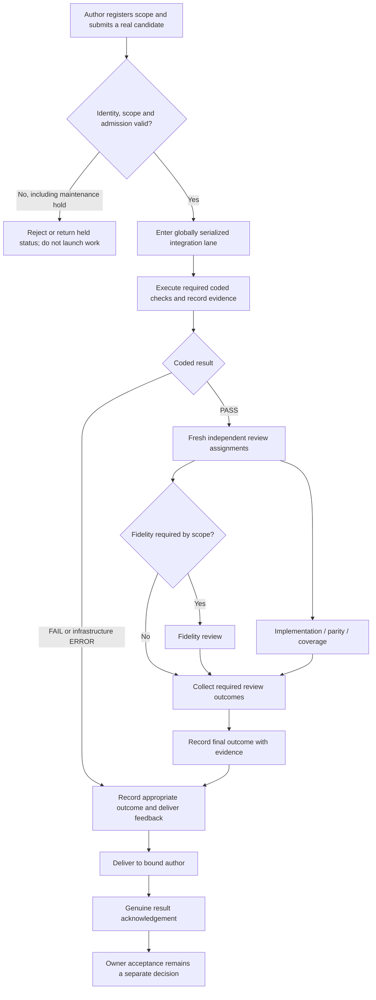
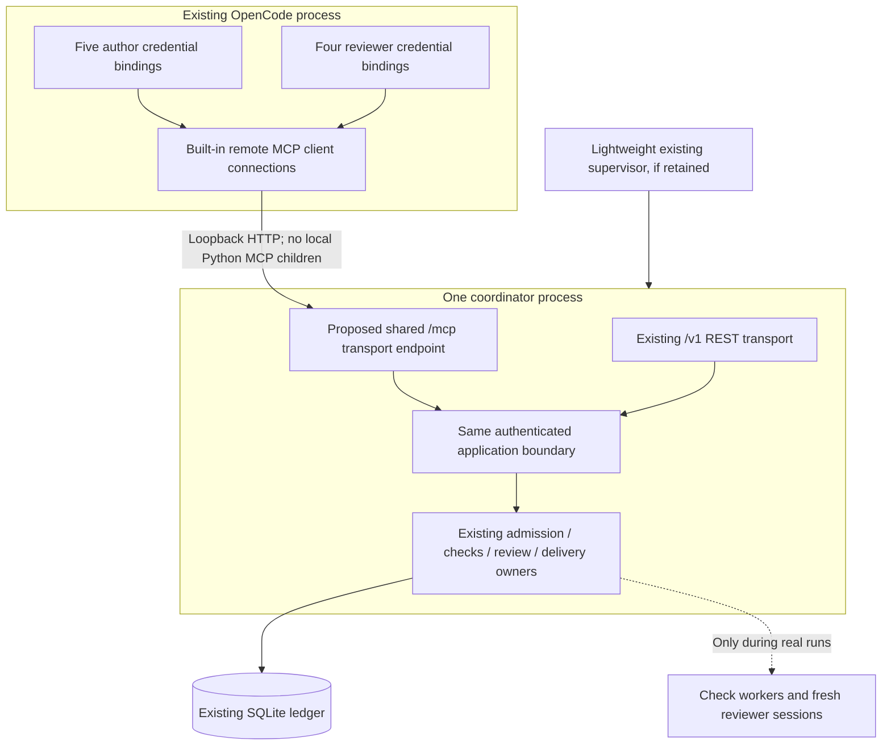
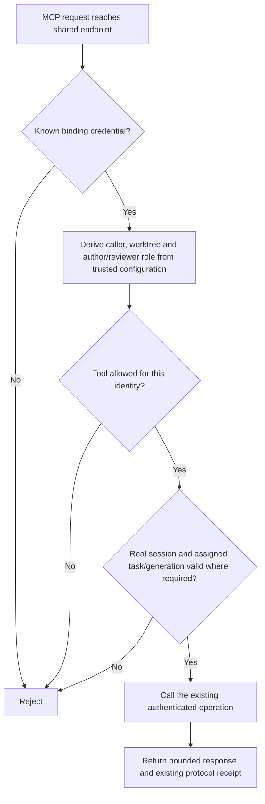
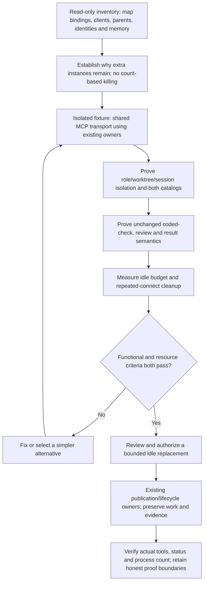

# Validation tools: bindings, processes, and idle resource design

**Status: design proposal, not implemented.** Written 2026-10-18. This document changes no running process, MCP configuration, credentials, or validation policy.

**Feasibility update:** the [source-audited feasibility review](MCP-FEASIBILITY-REVIEW.md) refines this initial proposal. The installed SDK's shared tool cache makes a single dynamically switched author/reviewer catalog unsafe. Use fixed, cache-isolated catalog profiles in the same coordinator process; separate profile URLs are acceptable. Private credential loading through scoped runtime configuration is still unproven. The direction is credible, **not integration-proven or ready for cutover**.

## 1. The answer in plain English

**We do not need 32 Python adapters, or 1.5 GiB of resident process working sets, just to make validation tools available.**

The current arrangement has nine configured MCP bindings but was observed with 32 adapter instances. These are different counts. The four reviewer bindings also expose **the same four tool names**, not four different test engines.

The useful requirements are:

- Coding agents can submit work and recover its status.
- The coordinator knows which worktree and real session is calling.
- Independent reviewers have distinct assignments and responsibilities.
- Coded checks run before AI review, with one authoritative scheduler and result ledger.

None of those requirements inherently demands a Python interpreter per binding, reviewer role, chat, or connection.

**Recommended direction:** use OpenCode's native remote-MCP client to connect to one shared MCP endpoint in the existing coordinator. Initially preserve the nine logical identities and credentials, but remove their local stdio adapter processes. Reducing the number of visible bindings is a separate, optional simplification—not a prerequisite for reducing memory.

The current design chose local stdio bindings for straightforward role-bound configuration. It did not establish an adequate process-count or idle-memory acceptance criterion. That was a design/acceptance gap. Functional test success does not make the observed resource footprint acceptable.

## 2. Five things that must not be confused

| Thing | Meaning | Needs its own OS process? |
|---|---|---|
| Tool definition | A name, description, and JSON argument schema | **No.** This is data. |
| Role/identity | Author, implementation reviewer, parity reviewer, etc. | **No.** Authorization records and task assignments suffice. |
| MCP binding | OpenCode configuration naming a server, transport, credentials, and tool namespace | **No.** It can reference a shared HTTP endpoint. |
| Connection/session | A client's communication channel and protocol state | **No.** Many can share one server process. |
| Local stdio adapter | A program that translates MCP messages into coordinator calls | **Yes, with the current local-command transport.** The host launches a child program for a client instance. |



**Four review responsibilities do not imply four processes.** Likewise, five worktrees do not inherently require five server processes.

## 3. What is installed today

### Logical bindings

- One author binding in MAIN and one in each of agents 01–04: **five**.
- Four reviewer bindings in MAIN: implementation, parity, coverage, and fidelity: **four**.
- Agent-05 is the preserved legacy integration directory, not a new author target.

| Catalog | Tools |
|---|---|
| Author | `register_scope`, `scope_status`, `submit`, `status`, `acknowledge_result` |
| Reviewer—all four roles | `claim_task`, `complete_review`, `report_error`, `status` |

The reviewer MCP names differ because their configured credentials, permissions, and responsibilities differ. Their generic tool catalogs do not. There is no separate MCP server for compilation, unit tests, GameTests, or each check pack.

### Current process topology



On Windows, each observed adapter instance had a small venv launcher and its actual Python interpreter: **32 instances, 64 processes**. The coordinator and supervisor each also had a launcher/interpreter pair. This is not 64 validation engines, but their memory still counts.

### Why use adapters at all?

OpenCode speaks MCP; the coordinator currently exposes an ordinary REST API. The adapter translates between them. It also validates tool arguments, reads bounded request/result files, and forwards authenticated session information.

That translation is necessary **somewhere** while these two interfaces differ. Running it in a separate interpreter for every client instance is not necessary. A shared MCP route can perform it inside the existing service.

“Thin adapter” describes narrow responsibility, **not** tiny memory consumption or a shared address space. Each current adapter loads Python, the MCP SDK and its dependencies, and application modules. In particular, importing `workflow_store` loads `jsonschema` and initializes protocol-schema validation. Source inspection establishes these paths; it does not attribute a measured number of MiB to each import.

The persistent launch helper also imports administrative transition/package modules into its supervisor host. Those imports may contribute to its footprint. Their individual contribution has not been profiled; the supervisor's measured memory should not be presented as an unavoidable minimum.

## 4. What the memory measurement actually says

Snapshot: **2026-10-18 09:13:55 -07:00**, filtered to the current installed coordinator and adapter commands.

| Component | Python processes, including launchers | Summed working sets | Private committed memory |
|---|---:|---:|---:|
| 32 MCP adapter instances | 64 | 1,360.12 MiB | 1,443.32 MiB |
| Supervisor instance | 2 | 135.87 MiB | 206.31 MiB |
| Coordinator instance | 2 | 34.78 MiB | 39.25 MiB |
| **Total** | **68** | **1,530.77 MiB ≈ 1.50 GiB** | **1,688.88 MiB ≈ 1.65 GiB** |

Important qualifications:

- Summed working sets can count shared resident pages more than once. They are not an exact unique-physical-RAM measurement.
- Private commit is memory committed for the processes, not necessarily all physically resident RAM.
- These totals exclude the OpenCode host itself, the persistent PowerShell wrapper, validation jobs, Minecraft/Gradle/JVM processes, and active reviewer conversations/provider work.
- The installed workflow's 29 application tables were empty at the last idle-preservation check. No production task/result was manufactured for installation testing.
- A separate **2.097-second** sample observed **0.0156 CPU-seconds** across the selected processes: about **0.745% of one core**, or **0.062% of this 12-logical-processor machine**. That is a short sample, not a sustained benchmark.

**Yes: this footprint was for the control plane existing, not for validation checks running.** Actual check workers and active review work add resource demand. Paging and shared pages mean their physical-memory impact is not a perfectly additive arithmetic sum, but they were not included in the table.

### Why 32 instances for nine bindings?

Observed counts were:

| Binding identity | Resident adapter instances |
|---|---:|
| Each of the four coding-worktree authors | 3 each |
| MAIN author | 4 |
| Each of the four MAIN reviewer roles | 4 each |
| **Total** | **32** |

The launcher parents were the same OpenCode host. This establishes multiple resident instances per configured identity. It **does not establish the lifecycle cause**. Possibilities to investigate include separately retained location/client instances, replacement/reconnection behavior, and child cleanup. We must not call these proven leaks, identify them as safe to kill from counts alone, or assume that nine configured entries guarantee nine live adapters.

A single set of nine adapters would still cost hundreds of MiB on the observed implementation. Therefore, merely reducing 32 to nine is not the recommended final solution.

## 5. What happens when tools are used

### Tool discovery and a read-only status call are not validation jobs

```mermaid
sequenceDiagram
    participant UI as OpenCode
    participant MCP as Current stdio adapter
    participant API as Coordinator API
    participant Store as Existing state/identity owners
    UI->>MCP: initialize / tools-list
    MCP-->>UI: Catalog of names and schemas
    Note over MCP,API: Listing tools does not start checks or AI review
    UI->>MCP: status with real session ID
    MCP->>API: Authenticated status request
    API->>Store: Verify scope/session; read state
    Store-->>API: Context or current result
    API-->>MCP: Status response
    MCP-->>UI: Tool result
```

The SDK/catalog checks used during installation did not prove a complete real validation/review/ACK cycle. Nine connected entries and direct SDK catalogs also remain distinct from manually verifying exact tool-picker visibility in OpenCode.

### Actual validation flow



This is the normal logical flow, not a replacement for the existing typed FAIL/ERROR/recovery rules. Python owns admission, prerequisites and transitions. AI supplies review judgment; reviewers do not replace the scheduler or independently run the validation gate.

The three ordinary review roles and optional fidelity role are **logical tasks**. Creating four MCP bindings does not run four models in the background. Real provider usage occurs when an actual reviewer session is dispatched. Tool schemas may also contribute context tokens during AI turns, depending on host filtering/caching; an open idle connection itself makes no model inference request.

## 6. Which parts are necessary?

| Part | Keep? | Reason |
|---|---|---|
| One authoritative coordinator and SQLite lifecycle ledger | Yes | Own ordering, durable outcomes, resource coordination and delivery. |
| Worktree/session identity checks | Yes | An author must not act as another worktree or session. |
| Reviewer assignment/role separation | Yes | Preserve independent responsibilities and task-bound result authority. |
| MCP, specifically | Optional interface | Convenient native tools; CLI/native tools could also reach the same owners. |
| Nine visible MCP binding names | Optional | Useful current configuration boundaries, not a protocol minimum. |
| Four different reviewer tool catalogs | No | There are only two catalog shapes: author and reviewer. |
| A Python adapter per binding/connection | No | A shared MCP server can serve many clients. |
| 32 resident adapter instances | No demonstrated requirement | Their lifecycle multiplication needs explanation and bounds. |
| Windows Python venv launchers | Current deployment detail | Not logically required by validation or role separation. |
| A supervisor | Operational choice | Useful process ownership/restart behavior; should remain lightweight if retained. |
| Always-on Python while no work is desired | Operational choice | Manual validation windows plus CLI/native tools could avoid it, with usability trade-offs. |

Independent AI reviews do not require independent MCP server processes. Their independence comes from fresh sessions, bounded inputs, separate task assignments and enforced result ownership.

## 7. Recommended design: one shared MCP endpoint



### What changes—and what does not

1. Implement a **real MCP transport** in the existing coordinator process. The current REST `/v1/...` endpoints are not MCP; merely pointing a remote-MCP config at them will not work.
2. Change local-command MCP entries into remote connections to that shared endpoint. Initially retain existing per-binding credentials and namespaces to avoid an unnecessary authorization redesign.
3. Reuse the current catalogs, bounded payload handling, task/session checks, admission, store and result owners. Do not add another scheduler, database, dashboard, broker process, or validation engine.
4. Have REST and MCP call the same authenticated application operations. Share/extract behavior within existing responsibilities instead of copying command handlers or accessing the store directly from a new bypass path.
5. Keep request-file resolution bound to the authenticated worktree. The current adapter reads files relative to its configured repo; moving this work centrally must not turn a caller-supplied repo or path into new authority.
6. Remove the persistent host's unnecessary administrative dependency retention after startup through an appropriately lightweight launch/proof arrangement. Preserve the existing process identity, containment and health guarantees; do not disable proofs merely to save RAM.

A role-separated remote binding is just configuration plus a connection inside OpenCode. It does **not** start a Python interpreter. A shared endpoint still has connection/session bookkeeping and SDK memory; it is not free, but it avoids replicating a full runtime per client.

### Authorization stays server-derived



Discovery can return the credential-appropriate catalog without admitting a task. An argument saying `role: parity`, a prompt claiming a role, an MCP session identifier, or a caller-supplied worktree is **not sufficient authorization**. Do not put mutable global “current role” state in a server shared by clients.

### Feasibility established versus still unverified

Read-only source checks found:

- The installed OpenCode executable contains a `Mcp.RemoteConfig` schema with `type: remote`, URL, headers and optional OAuth settings, and a `StreamableHTTPClientTransport` implementation.
- The installed Python MCP SDK is **1.26.0** and includes `StreamableHTTPSessionManager`, with documented Starlette lifespan integration and session management.

This establishes that relevant transport mechanisms exist. It **does not** prove this project's mounted endpoint, exact handshake, credential flow, cleanup, or memory savings. Those are future implementation/fixture checks.

In particular, preserve private credential storage. Verify how this installed host can supply remote authorization headers from private token references and how scoped runtime loading handles those references. Do not solve it by writing bearer values into committed configuration, public evidence, or logs. If the needed host behavior is unavailable, resolve that concrete constraint before selecting the final transport/configuration—not by silently adding another always-on credential broker.

Use the official SDK's lifecycle/session owner. Existing loopback REST forwarding cannot simply be moved into an async MCP handler as a blocking self-HTTP call: shared-loop/thread-pool contention can deadlock or stall it. Prefer a small shared in-process application boundary; retain the current validation and authorization semantics at that boundary.

### Why the original plan retained stdio—and what sharing costs

The original [`DESIGN.md`, section 3](DESIGN.md#3-technology-and-reuse) explicitly retained the **existing per-workspace stdio adapters**, converting them into thin clients of the new coordinator. This was reuse of an existing integration surface, not a requirement that every identity have its own interpreter. Separate bindings also made credentials and per-agent tool permissions explicit.

The practical architectural benefits were straightforward local-command wiring, process-local credential/repo context, and a separate process/event loop for each MCP frontend. Those are properties of the arrangement; the historical design does not establish that all were deliberate reasons for rejecting shared HTTP. It does not say that the SDK required stdio, HTTP was unavailable, or security required separate processes. The missing resource budget and unexplained multiplication to 32 instances remain gaps, not justified costs of independent review.

| What we give up or must replace | What the proposed design needs instead |
|---|---|
| One adapter can crash or restart without crashing other adapters or the coordinator | Shared MCP bugs, memory growth, or blocking work must not stall or crash the coordinator. In-process sharing genuinely enlarges the MCP fault domain; tests reduce risk but do not recreate OS process isolation. |
| Credential/repo context naturally stays inside a single configured adapter process | Immutable request-local identity derived from the credential, with the existing authoritative worktree/session/task checks. No shared mutable “current caller.” |
| OpenCode launches the local MCP child and pipe closure participates in its lifetime | Explicit shared-service startup/readiness, SDK session lifetime, disconnect/reconnect and bounded cleanup. The existing coordinator supervisor remains the service owner. |
| MCP SDK dependencies and frontend changes live outside the coordinator process | SDK lifecycle and dependency compatibility join the coordinator's process/release boundary. Independent frontend restart/update granularity is reduced. |
| Local adapter reads a private token file and sends existing REST authentication | A verified private-header configuration path for native remote MCP; no secrets in public config/evidence. |

**The old system already had one shared coordinator.** Its failure already affected every adapter. The change loses *frontend-level* isolation and convenient per-client packaging; it does not destroy nine independent validation engines, because those never existed.

We should not lose review roles, fresh-session independence, permissions, evidence, serialization, or result ownership. Those are existing application guarantees to preserve and test. Nor does “remote MCP” require an internet service here: the endpoint remains loopback-local. Lower memory is the expected benefit of removing runtime replication, not a measured result yet.

## 8. Alternatives and why they are secondary

| Option | Idle process consequence | Main trade-off | Recommendation |
|---|---|---|---|
| **Shared remote MCP; keep nine logical bindings** | No local Python adapter children; one coordinator and optional supervisor | Needs actual MCP endpoint and verified credential/lifecycle integration | **Preferred first correction.** Lowest policy disruption. |
| Shared remote MCP; reduce to roughly one binding per worktree | Same shared process count; fewer visible entries | MAIN combines author/reviewer access; needs a trustworthy way to select existing identities without trusting a role argument | Optional later UI simplification, not the RAM fix. Exact binding count is not an architectural invariant. |
| Keep stdio, reduce duplicates and trim imports | Still roughly one interpreter per retained client instance | Can lower waste, but a single nine-adapter set still costs hundreds of MiB here | Interim mitigation only. Do not declare acceptable solely because count reaches nine. |
| Native execute/CLI access; explicitly start coordinator for validation windows | Can avoid idle MCP children, and avoid always-on coordinator when intentionally stopped | Less convenient tool discovery, startup latency and operator/agent instructions; must preserve authentication, receipts and task ownership | Viable if near-zero idle Python memory is the priority. Reuse the same engine. |

Consolidating four reviewer names into one **stdio** binding could reduce some children, but it is not equivalent to shared transport and does not by itself solve multiple instances or separate worktree adapters. A single shared credential plus an unverified role parameter is not an acceptable shortcut.

## 9. Resource acceptance—not just functional acceptance

Proposed engineering targets, **not measured achievements or owner-approved limits**:

- **Zero long-lived Python stdio MCP adapter instances** in the preferred remote design.
- One coordinator process and, if retained, one lightweight supervisor instance; count any Windows launchers separately and include their memory.
- Aim for **at most 200 MiB combined private commit** for those long-lived Python components, including the shared MCP endpoint.
- Aim for **at most 250 MiB incremental idle private commit overall**, including the connection-attributable increase in the existing OpenCode host and required wrappers. Establish the baseline in a fixture; do not equate the entire existing OpenCode host with new validation overhead.
- Stable client/session/process counts after repeated discovery, reconnect and configuration-replacement cycles. Explicitly account for legitimate concurrent clients; do not assume nine bindings always means nine connections.
- No idle provider inference, spontaneous check workers or reviewer sessions.
- Sample sustained idle CPU and disk activity over a meaningful interval; the current two-second sample is insufficient for a guarantee.

If the targets cannot be met, report the measured breakdown and choose a simpler lifecycle/interface or agree a different budget. Do not publish estimated savings as measured success. The rough 0.5–0.7 GiB estimate for one current stdio set is **not** an accepted target.

Measure active validation separately: peak worker memory, allowed concurrent work, review-session/context overhead and provider usage. Removing adapter replication does not make Gradle, Minecraft servers/clients, tests, or AI review free.

## 10. Implementation and validation sequence—future work



The fixture should cover concurrent author/reviewer connections, role-inappropriate calls, wrong sessions/generations, unavailable service, bounded payloads, and client disconnect/reconnect/replacement cleanup. Confirm the host does not keep spawning local adapters and that remote sessions do not grow without bound.

Any eventual cleanup must use exact process/connection ownership and the host's scoped lifecycle mechanisms. Do not kill all Python, terminate the shared OpenCode host, globally reload locations, reconstruct stopped authors, or create fake production tasks/results to prove a real ACK. No rolling-handoff framework is needed for an authorized idle replacement.

**This document authorizes none of those implementation or runtime actions.** It is design-only: no coding candidate, integration-gate dispatch, or new runtime asset was created to deliver it. Actual implementation would need the applicable focused technical checks and explicit runtime authorization.

## 11. Source and evidence index

- Current installed boundary: [`installed-idle-192-evidence.json`](../../build/agent-workflow/workflow-redesign-plan/wr12/installed-idle-192-evidence.json). Its functional proofs do not establish acceptable memory or a stable MCP client lifecycle.
- [`workflow_coordinator_mcp.py`](../../tooling/agent_workflow/workflow_coordinator_mcp.py): `SCHEMAS`, `WORKTREE_SCHEMAS`, `REVIEW_SCHEMAS`, `CoordinatorClient.tools/call`, `main`; current local stdio startup and REST forwarding.
- [`workflow_coordinator_bindings.py`](../../tooling/agent_workflow/workflow_coordinator_bindings.py): `merge_bindings`, role namespaces/credentials/permission rules; current local-command generation.
- [`workflow_coordinator.py`](../../tooling/agent_workflow/workflow_coordinator.py): author/reviewer bindings, identity checks, existing routes, admission and serving loop.
- [`workflow_store.py`](../../tooling/agent_workflow/workflow_store.py): protocol-schema initialization, durable lifecycle/task/resource authority.
- [`workflow_supervisor.py`](../../tooling/agent_workflow/workflow_supervisor.py): process-only supervisor and owned child lifecycle.
- Current administrative launch caller: `build/agent-workflow/workflow-redesign-plan/wr12/attempts/idle-supervisor-launch-4be3c1f2-7d9a-47c4-97da-3c295a846db1/launch_supervisor.py`.
- Source-only feasibility observations: installed OpenCode executable remote-config/Streamable HTTP implementation; installed SDK `mcp/server/streamable_http_manager.py` from version 1.26.0. No transport runtime experiment was performed for this design.
- Resource numbers in section 4 are read-only live observations from this conversation's overhead investigation, not a new validation test or an attributed leak diagnosis. The older [`HANDOFF.md`](HANDOFF.md) is useful for architecture but contains historical pre-install status; do not use that status instead of the current installed evidence.

**Decision proposed:** preserve the workflow and identity guarantees; replace replicated local MCP runtimes with shared transport, and make idle resource usage an explicit acceptance condition. The current 1.5 GiB footprint is not justified merely by having validation tools available.
